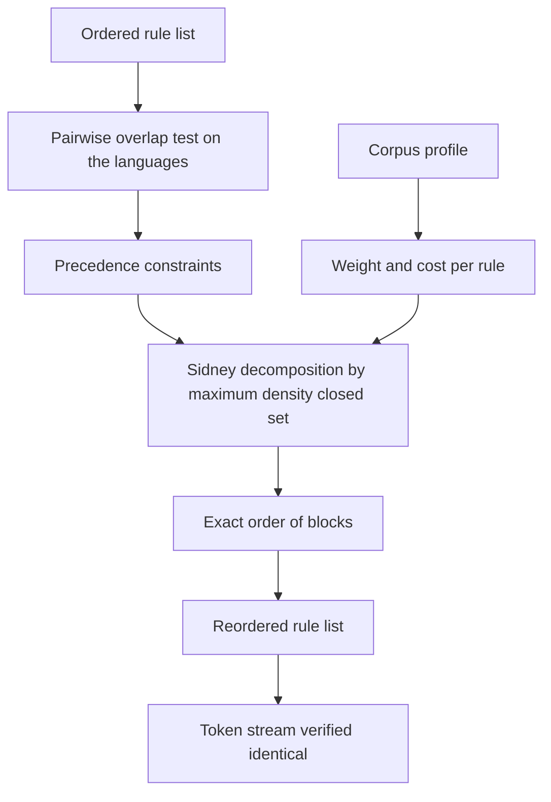
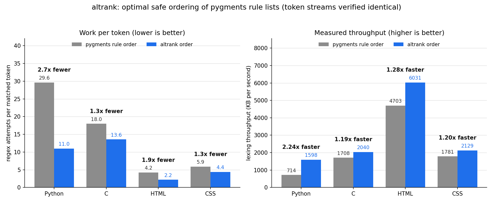

# altrank

Reorders an ordered list of regexes so the rules that usually win are tried first, and proves the match result cannot change.

## The problem

A surprising amount of real software scans text with an ordered list of regexes: try each pattern at the current position, take the first one that matches, advance, repeat. Syntax highlighters, log parsers, tokenizers and URL routers are all built this way. The inner loop of pygments is literally this:

```python
for rexmatch, action, new_state in statetokens:
    m = rexmatch(text, pos)
    if m:
        ...
        break
```

In a list like this the order is load bearing. If the rule for `=` is tried before the rule for `==`, then `==` is read as two assignments and the output is wrong. Because order carries meaning, nobody reorders these lists for speed, so the order ends up being whatever read well to the person who wrote it. The rules that actually fire most often are frequently near the bottom, and every token pays for the misses above them.

Measured on the CPython standard library, the pygments Python lexer attempts **29.6 regexes for every token it emits**. The two rules that win most often, horizontal whitespace and punctuation, sit at positions 35 and 43 of 54.

Sorting the list by how often each rule wins is the obvious fix. It is also wrong: it breaks the lexer on the very first token (see `examples/unsafe_vs_safe.py` below). That is the gap altrank fills.

## What it does

altrank takes an ordered rule list and returns a faster ordering of the same rules, along with the reason it is allowed to.

1. **Profile.** Run the real scan loop over a real corpus and count, per rule, how often it is the winner and what one attempt costs.
2. **Prove.** For every pair of rules, decide whether any input position exists at which both could match. If none exists, their order is irrelevant and they may be swapped freely. If one exists, the earlier rule wins there and the relative order must be preserved.
3. **Schedule.** Minimise the expected number of attempts subject to those ordering constraints.

Step 2 is the part that makes this safe rather than merely plausible. Writing `L(A)` for the set of strings rule A matches, swapping A and B changes behaviour exactly when some word of one is a prefix of a word of the other, which is the same as asking whether

```
L(A) . Sigma*    intersect    L(B) . Sigma*
```

is non-empty. Both sides are regular languages, so this is decided exactly by a product construction over the two automata, with no reference to any corpus. A reordering that altrank accepts is therefore correct on every possible input, not just on the files it was profiled against.

Patterns using constructs altrank does not model exactly (lookaround, word boundaries, anchors, backreferences) are not rejected. They are replaced by a language that is guaranteed to be a **superset**: assertions become epsilon, backreferences become `Sigma*`. Widening a language can only turn "disjoint" into "overlapping", never the reverse, so the analysis stays sound and simply becomes more conservative.

## Why it is interesting

The obvious approach fails twice over, and for two different reasons.

**It is unsafe.** Sorting by frequency moves general rules ahead of the specific rules they shadow. On the CPython standard library this changes the token stream at token 0: a module docstring is re-read as a single `"` string.

**It is also suboptimal.** Once the safety constraints are in place, the problem of ordering the rules is the classic single machine scheduling problem of minimising total weighted completion time, written `1 | prec | sum w_j C_j`. With no constraints the optimum is Smith's ratio rule, sort by weight over cost. With constraints the problem is NP-hard in general, and a greedy frequency order leaves most of the win on the table. Given exactly the same safety constraints on the pygments Python lexer, repeatedly taking the highest weight rule whose constraints are already satisfied reaches 25.5 attempts per token. The exact method reaches 11.0, from a baseline of 29.7. Both orderings are equally correct; the difference is entirely the scheduler, and `python bench/compare_orders.py` reproduces it.

altrank uses Sidney decomposition. The maximum-density closed set of rules can always be scheduled first by some optimal sequence, which is found exactly as a maximum weight closure via a minimum cut. That splits the instance into blocks whose order is provably right, and because the elapsed time ahead of a block is fixed once the block order is, each block can be optimised independently. Blocks small enough to solve by dynamic programming over order ideals are solved exactly, and a schedule whose every block was solved exactly is reported as **certified optimal**. The scheduler is checked against exhaustive search on 300 random instances in the test suite.

The useful consequence is that a cold, cheap rule gets pulled forward when it unlocks a hot one behind it, which no frequency ranking will ever do.

## Architecture

FigJam board: https://www.figma.com/board/B0kHitPFcbx9awki4u93XK

The diagram shows the two independent inputs to the scheduler: the pattern text, which yields the safety constraints and depends on no corpus, and the profiled corpus, which yields the weights and costs and affects only speed.



## Results



The metric is the number of regex attempts pygments makes per token it emits, counted by instrumenting the real scan loop, plus the wall clock throughput of lexing the same corpus. The baseline is the rule order that ships in pygments 2.19.2. Every corpus is real and ships with CPython, so the run reproduces on a stock interpreter.

| Target | Corpus | Attempts per token | After | Fewer | Throughput | After | Faster |
| --- | --- | --- | --- | --- | --- | --- | --- |
| Python | 14 stdlib modules, 123 KB | 29.64 | 10.97 | 2.70x | 714 KB/s | 1598 KB/s | 2.24x |
| C | 77 CPython headers, 362 KB | 17.97 | 13.56 | 1.33x | 1708 KB/s | 2040 KB/s | 1.19x |
| HTML | idlelib help page, 60 KB | 4.22 | 2.18 | 1.94x | 4703 KB/s | 6031 KB/s | 1.28x |
| CSS | 7 documentation sheets, 49 KB | 5.87 | 4.39 | 1.34x | 1781 KB/s | 2129 KB/s | 1.20x |

For the Python lexer that is 805,762 regex attempts reduced to 298,290 over the same corpus, and the token stream is byte for byte identical in all four cases, checked token by token after reordering. Timings are the minimum of five runs with the two configurations interleaved round robin, so a slow moment on the machine cannot be read as a difference between the orderings. Raw numbers are in `docs/results.json`.

The size of the win tracks how badly the shipped order matches the observed one. Python gains most because its two hottest rules sat at positions 35 and 43 of 54. C gains least: its 124 rules carry 272 ordering constraints, many of them from keyword rules that genuinely must precede the identifier rule, so much less of the list is free to move.

That last point is worth stating plainly, because it bounds the whole approach. If safety could be ignored entirely, the Python lexer would need only 3.65 attempts per token rather than 10.97. The remaining distance is not slack that altrank failed to take, it is the price of correctness: the identifier rule cannot move ahead of the 37 keyword and literal rules it would otherwise shadow, so it cannot be tried earlier than 38th no matter how often it wins. altrank reports that floor alongside its result rather than quietly optimising past it.

## How to run it

```
pip install -r requirements.txt
```

Reorder a lexer and see what changed:

```
python -m altrank.cli --lexer pygments.lexers.python.PythonLexer \
                      --corpus "C:/Python313/Lib/*.py" --limit 14
```

On Linux or macOS, point `--corpus` at your own standard library, for example `--corpus "/usr/lib/python3.13/*.py"`. Add `--json report.json` to write the full per state report, including the permutation for each rule list, which is what you would apply upstream.

Reproduce the chart and the table above:

```
python bench/run_bench.py
```

This writes `docs/before_after.png` and `docs/results.json`. It finds its corpora through `sysconfig`, and skips any target whose corpus is not present rather than inventing numbers. Pass `--redraw` to rebuild the chart from saved results.

Compare orderings that all obey the same safety constraints, which isolates the scheduler:

```
python bench/compare_orders.py
```

Walk through one rule list in detail, and see the naive approach break:

```
python examples/optimize_python_lexer.py
python examples/unsafe_vs_safe.py
```

Run the tests, which include a soundness fuzzer for the overlap test and an exhaustive check of the scheduler:

```
python tests/test_overlap.py
python tests/test_schedule.py
```

## Example output

`python examples/optimize_python_lexer.py`, on ten CPython standard library modules:

```
state 'root' has 54 rules, 14133 match events

safety analysis: 80 of 1431 rule pairs must keep their order (7.0s)
15 rules were over-approximated, so altrank treats them pessimistically

was   now        wins   pattern
35    8          3561   [^\S\n]+
43    4          3141   []{}:(),;[]
1     1          2115   \n
54    45         1559   [A-Z_a-z\xaa\xb5\xba\xc0-\xd6\xd8-\xf6\xf8-...
42    3           885   !=|==|<<|>>|:=|[-~+/*%=<>&^|.]
8     9           525   (a(?:s(?:(?:sert|ync)?)|wait)|break|continu...
48    10          410   (?<!\.)(self|Ellipsis|NotImplemented|cls)\b
30    12          379   ([uU]?)(')

attempts per matched token: 32.75 before, 11.61 after
unreachable floor if safety were ignored: 4.00
Sidney blocks: 16, solved exactly: 15, certified optimal: False

why rule 35 cannot lead: 3 rules must precede it, for example rule 2
  rule 2   ^(\s*)([rRuUbB]{,2})("""(?:.|\n)*?""")
  rule 35  [^\S\n]+
  reason: both rules can match at the same position

token stream after reordering: identical (16166 tokens)
```

The last block is the analysis earning its keep. Horizontal whitespace is the single hottest rule in the lexer, but it cannot be tried first, because the triple quoted string rule begins `^(\s*)` and so can also match at a position where only whitespace follows. A frequency ranking has no way to know that. altrank moves the rule as far forward as the proof allows, to position 8, and stops.

`python examples/unsafe_vs_safe.py`, showing why the analysis is not optional:

```
sort every rule list by win count, ignoring overlap
  token stream: DIFFERENT
  first divergence: token 0
      original:  Token.Literal.String.Doc '"""Record of phased-in incompatible language chan...
      reordered: Token.Literal.String.Double '"'

altrank order, with the overlap analysis switched on
  token stream: identical (10792 tokens)
  ordering constraints honoured: 239 conflicting rule pairs
  attempts per matched token: 30.93 before, 11.33 after
```

## Scope and limits

- The safety proof covers rule lists where each rule is a separate compiled pattern, which is how pygments, most log parsers and most routers are written. Reordering branches inside a single `|` alternation is a different problem, and measurably not worth it. Applying the same frequency-driven reordering to the 48 way operator alternation inside CPython's own `tokenize` module cut the mean branch index from 30.9 to 9.9 and changed wall clock by 1.001x: a failed branch inside one compiled pattern is far cheaper than a failed `match()` call, which is why altrank targets rule lists instead.
- Rules whose patterns use lookaround, anchors, word boundaries or backreferences are handled conservatively, not exactly. They are safe, just more constrained than they strictly need to be.
- A rule that can match the empty string matches at every position, so it is treated as conflicting with everything and never moves.
- The analysis cost is real: a few seconds to a minute per lexer, dominated by the pairwise automaton products. It is meant to run once and have its output applied, not to run at import time.

## Layout

```
altrank/charset.py   interval sets over codepoints
altrank/rxparse.py   regex to a guaranteed superset language
altrank/nfa.py       Thompson construction and the Sigma* closure
altrank/overlap.py   can two rules match at the same position
altrank/maxflow.py   Dinic max flow and maximum weight closure
altrank/schedule.py  Sidney decomposition, exact blocks, lower bounds
altrank/profile.py   win counts and attempt costs from a real corpus
altrank/optimize.py  end to end, plus the equivalence check
altrank/cli.py       command line entry point
```

## License

MIT
